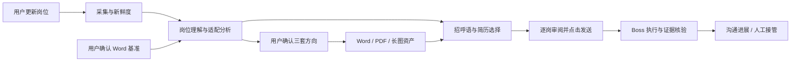

# 系统架构与演进边界

2026-09-10；依据当前源码静态核对。这里区分现有实现与目标，不代表实时服务或 Boss 已验证。

## 架构选择

保留 Python 模块化单体、SQLite、原生 HTML/JS 审阅台，个人 Windows 本地运行。现阶段不引入微服务、消息队列或前端重写。用清晰的任务状态和版本边界解决恢复与审核问题。

所有外部动作通过应用服务进入平台适配器；模型只产生建议和内容，不直接持有发送能力。渲染不访问 Boss，采集不调用模型或发送消息。SQLite 保存业务记录与任务状态，文件系统保存不可变资产，数据库引用其版本。

## 当前代码与目标职责

| 边界 | 当前代码及已具备能力 | 待完成 |
|---|---|---|
| 入口与界面 | `main.py`、`review_server.py`、`review_ui/`，本地筛选与投递准备界面 | 统一更新任务、三套资产选择、一次发送与进展同步 |
| 采集与有效性 | `collection.py`、`freshness.py`、`platforms/boss_collector.py`，详情、观察记录、版本、新鲜度和复扫 | 按轮更新，持久化总任务，来源覆盖与部分失败，统一浏览器互斥 |
| 分析与决定 | `analysis.py`、`matching.py`、`calibration.py`、`review.py`，规则分析、档案、匹配历史、人工决定 | 统一 AI 岗位理解与证据输出、确认的 Word 事实来源、三方向分析 |
| 模型适配 | `ai.py`，OpenAI-compatible 调用 | 统一记录模型/思考强度/提示词版本、结构验证和可解释失败；预期默认 `gpt-5.6-terra` / `high`，实际从配置读 |
| 简历与投递包 | `outreach.py`，招呼语、逐岗重排、Word/长图渲染、审核 | 拆出复用的三套版本化资产；替代逐岗重写；取消两页硬限制；不可变包历史 |
| 执行 | `platforms/boss.py` 有历史文本发送路径 | 图片发送、目标身份校验、逐动作结果核验和恢复；历史发送不等于新流程验收 |
| 试点 | `pilot.py` 本地计划 | 去除分数硬门槛和文件时间硬门槛，改用明确确认版本；最多 3 岗逐岗发送 |

## 数据归属

现有表组：`job_observations` / `job_details` / `detail_collection_runs` / `collection_cursors` 为采集事实；`job_freshness` / `job_detail_versions` / `job_refresh_events` 为有效性与版本；`job_match_analyses` / `job_match_history` 为匹配；`job_decisions` / `job_decision_history` 为人工决定。

`job_outreach` 当前按岗位覆盖更新，不等于完整包历史。旧 `jobs` 表和旧自动投递入口不能成为新版发送权威。

拟新增的概念，按阶段才建表：

- 更新任务及任务项：冻结本轮参数、来源、目标、进度、停止原因、完成覆盖；复用已有详情和版本表。
- 简历基准和三套资产版本：明确导入时间、确认者、来源文件内容标识、父版本、Word/PDF/长图路径。
- 岗位分析：关联 JD 内容版本、档案版本、模型及提示词版本；原文片段支撑每条判断。
- 审核包和发送动作：不可变审核快照；文本/图片分开持久化；动作唯一键阻止重复执行。
- 沟通事件：会话身份、事件时间、采集时间、证据引用、人工修正和结果历史。

不同时引入另一套岗位主表。对已有 SQLite 的变更必须可重复迁移，保留人工决策和旧详情；破坏性迁移不属于当前范围。

## 关键设计决定

1. 先更新数据再分三方向，避免用过期样本固化定位。搜索使用现有已确认的关键词和城市，不依赖尚未产生的三方向。
2. 资产确认与逐岗审核分离：三套长图可复用，审核绑定具体版本，不能发送时临时重新渲染。
3. 更新、旧采集、发送、进展同步共用浏览器执行租约。页面 GET 只读本地数据；重启不能自动恢复外部动作。
4. 长耗时操作返回任务标识；持久化状态为准，不依赖守护线程的内存字典。
5. 旧默认 `main.py` 的全自动发送链路必须在新版发送上线前封闭或明确禁用，不能绕过逐岗确认。

替代方案：继续在逐岗包生成中改写整份简历会放大不稳定性；直接把旧自动发送按钮接到审阅台会丢失审核与核验边界，均不采用。

需求权威见 [产品契约](product-contract.md)，落地顺序见 [实施 spec](specs/v1-controlled-outreach.md)。
